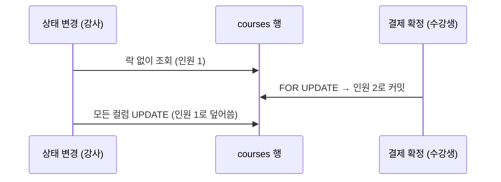

<!-- ============================== HEADER ============================== -->

  

  

 

## 👋 About Me

**데이터 정합성**과 **수치로 확인한 개선**을 중요하게 여기는 백엔드 개발자 소예은입니다.

- 코드와 쿼리에서 원인을 찾아 고치고 **동일한 조건에서 변경 전후를 비교**합니다.
- 요청이 동시에 몰려도 수강 인원이 어긋나지 않도록 **락을 설계하고 동시성 테스트로 검증**했습니다.
- 데이터가 늘수록 쿼리 수가 함께 늘어나는 조회 구조를 고쳐 **응답 시간을 약 93% 줄였습니다.** (로컬 측정)
- 팀 의견이 나뉠 때는 **두 방법을 일부 데이터로 먼저 비교**하고 결과를 함께 확인한 뒤 결정합니다.

 

## 📈 Highlights

<table>
  <tr>
    <td align="center" width="25%">
      <h2>−93%</h2>
      <b>강의 목록 조회</b> median 1740ms → 122ms N+1 해결, 강의 5,000건
    </td>
    <td align="center" width="25%">
      <h2>30 → 1</h2>
      <b>마지막 1자리 동시 확정</b> 30명 동시 요청 중 1건만 확정 비관적 락과 락 순서 설계
    </td>
    <td align="center" width="25%">
      <h2>−58%</h2>
      <b>게시글 목록 조회</b> median 82.54ms → 34.45ms ID 선조회 + Fetch Join
    </td>
    <td align="center" width="25%">
      <h2>70 → 80%</h2>
      <b>의류 패턴 19종 분류</b> VGG16 → MobileNetV3Large ACK 2024 제1저자 논문
    </td>
  </tr>
</table>

※ 성능 수치는 로컬 환경에서 k6로 측정한 결과입니다.

 

## 🛠 Tech Stack

<table>
  <tr>
    <td width="130"><b>Language</b></td>
    <td>
      
      
    </td>
  </tr>
  <tr>
    <td><b>Backend</b></td>
    <td>
      
      
      
      
      
    </td>
  </tr>
  <tr>
    <td><b>Database</b></td>
    <td>
      
      
    </td>
  </tr>
  <tr>
    <td><b>Infra</b></td>
    <td>
      
      
      
    </td>
  </tr>
  <tr>
    <td><b>Testing</b></td>
    <td>
      
      
      
      
    </td>
  </tr>
  <tr>
    <td><b>AI</b></td>
    <td>
      
      
      
    </td>
  </tr>
  <tr>
    <td><b>Tools</b></td>
    <td>
      
      
      
    </td>
  </tr>
</table>

 

## 💻 Featured Projects

### [ClassEnrollmentSystem](https://github.com/sohhhyeeun/class-enrollment-system) - 수강 신청 시스템
`개인` | 2026.05, 2026.09 – 2026.10 | Java, Spring Boot, JPA, MySQL, k6, GitHub Actions

정원을 관리하고 강의 상태(DRAFT / OPEN / CLOSED)를 자동으로 전환하는 수강 신청 API입니다. **요청이 동시에 몰려도 수강 인원이 어긋나지 않도록** 설계하고 테스트로 검증했습니다.

| 영역 | 결과 |
| :-- | :-- |
| **동시성** | 마지막 1자리에 30명이 동시에 결제를 확정해도 **1건만 확정** (Course 락 해제 시 2회 실행에서 10건, 2건 확정) |
| **후속 검증** | 락 없이 동작하던 강의 상태 변경이 수강 인원을 덮어쓰는 문제를 재현 테스트로 확인하고 수정 (수정 전 3/3 실패, 수정 후 **3/3 통과**) |
| **성능** | JPQL Fetch Join으로 N+1을 해결해 SQL을 **6회에서 1회**로 줄이고 median 응답 시간을 **1740ms에서 122.34ms**로 단축 (강의 5,000건) |
| **품질** | 동시성 통합 테스트 포함 **테스트 14개**, MySQL 8.0 기반 GitHub Actions CI, jackson-databind CVE 2건 대응 |

<b>문제 해결: 같은 신청 건에 중복 요청이 들어오면 수강 인원이 두 번 반영되는 문제</b>

 

**문제** - Course에만 비관적 락을 적용한 상태에서는 더블클릭이나 재시도로 같은 신청 건에 확정/취소 요청이 두 번 들어오면 두 요청 모두 `PENDING` 상태 검사를 통과해 수강 인원이 두 번 반영됐습니다.

**원인** - 두 요청은 Course 락을 기다리기 **전에** 이미 신청 상태를 읽고 검사를 통과합니다.

**대안 비교**

| 대안 | 판단 |
| :-- | :-- |
| **Enrollment 비관적 락** | ✅ 채택 - 기존 Course 락과 방식이 같고 새로 생기는 대기는 같은 신청 건의 중복 요청 사이에서만 발생 |
| 조건부 `UPDATE ... WHERE status = ?` | 상태 검사를 SQL로 옮겨야 하고 취소는 상태별 분기 필요 |
| `@Version` 낙관적 락 | 스키마 변경 필요, 한 로직 안에서 동시성 방식이 섞임 |

**해결** - `findByIdWithPessimisticLock`을 추가하고 데드락 방지를 위해 락 순서를 **Enrollment → Course**로 고정. 
**검증** - 같은 신청 건의 동시 확정/취소와 서로 다른 사용자의 마지막 자리 경합을 다룬 통합 테스트 3개가 로컬(MariaDB 10.11)과 CI(MySQL 8.0)에서 모두 통과.

<b>후속 검증: 락을 거치지 않는 쓰기 경로의 갱신 손실</b>

 

Hibernate는 기본 설정에서 바뀐 컬럼만이 아니라 모든 컬럼을 UPDATE합니다. 강사의 상태 변경이 락 없이 강의를 조회한 뒤 저장하기 전에 결제 확정이 커밋되면 처음 읽은 인원 값으로 덮어써 확정 1건이 인원에서 사라질 수 있었습니다.

- 래치로 실행 순서를 고정한 `CourseStatusConcurrencyIntegrationTest`로 재현 (수정 전 3/3 실패)
- `@DynamicUpdate`는 인원 값은 보호하지만 상태 값 사이의 덮어쓰기는 막지 못해 **재현 테스트를 통과해도 해결된 것으로 판단하지 않음**
- 상태 변경 조회에도 비관적 락을 적용해 "Course 행은 잠근 뒤 수정한다"는 규칙을 모든 쓰기 경로에 맞춤 (수정 후 3/3 통과, 회귀 없음)

<b>문제 해결: 강의 목록 조회 N+1</b>

 

`Course.user`(LAZY)를 응답 DTO에서 즉시 참조해 강의 N건 조회 시 쿼리가 1+N번 실행됐습니다. 저장소의 기존 `@Query` 컨벤션에 맞춰 `@EntityGraph` 대신 **JPQL Fetch Join**을 선택하고 `findAll`/`findByStatus` 두 메서드를 하나로 통합했습니다.

| 규모 | 개선 전 median | 개선 후 median | 격차 |
| :--: | --: | --: | :--: |
| 100건 | 42.84ms | 11.96ms | 3.6× |
| 1,000건 | 362.42ms | 31.26ms | 11.6× |
| 5,000건 | 1740ms | 122.34ms | **14.2×** |

측정 조건: 로컬 MariaDB 10.11, VU 1로 60회 순차 요청

 

### [NETMONG](https://github.com/besp-team1/NetMong) - 반려동물 커뮤니티
`팀 BE 5명` | 2023.11 – 2023.12, 개인 후속 작업 2026.03 | Java, Spring Boot, JPA, JWT, MariaDB, Docker, AWS S3

| 영역 | 내용 |
| :-- | :-- |
| **담당** | 게시글(해시태그 포함) CRUD, 카테고리/해시태그 검색 |
| **모델링** | `@ManyToMany`를 중간 엔티티 `PostHashtag` 구조로 재설계해 매핑 정보를 직접 관리 |
| **성능** | 개인 후속 작업([NetMong-Refactoring](https://github.com/sohhhyeeun/NetMong-Refactoring))에서 목록 조회를 ID 선조회(DB 페이징) + Fetch Join으로 바꿔 median 응답 시간을 **82.54ms에서 34.45ms로 58%** 단축 |

<b>문제 해결: 해시태그 추가 후 느려진 게시글 목록 조회</b>

 

해시태그 필드를 추가한 뒤 페이지를 조회할 때마다 라운드트립이 4회 발생했습니다. 쿼리 수를 줄이는 방식과 DB 페이징을 유지하는 방식을 같은 조건에서 비교했습니다. **컬렉션 Fetch Join + Pageable**은 쿼리가 1번으로 줄지만 Hibernate가 인메모리 페이징으로 전환(`HHH000104`)해 전체 결과를 메모리에 올립니다.

| 케이스 | 방식 | median |
| :--: | :-- | --: |
| A | 지연 로딩 (개선 전) | 82.54ms |
| B | 컬렉션 Fetch Join + Pageable | 239.16ms |
| **C** | **ID 선조회 + Fetch Join (채택)** | **34.45ms** |

**DB 페이징을 유지**하면서 라운드트립을 3회로 줄인 C를 채택했으며 median 기준 B보다 약 7배 빠릅니다.

 

<table>
  <tr>
    <td width="50%" valign="top">
      <h3><a href="https://github.com/FarmersAndFarmmunity/farmers">FARMERS</a> - 농수산물 직거래 오픈 마켓</h3>
      <code>팀 BE 4명</code> | 2023.05 – 2023.06 | Java, Spring Boot, Spring Security, OAuth2, JPA, MariaDB
        
      <ul>
        <li>카카오/네이버 소셜 로그인</li>
        <li>응답 구조가 다른 두 플랫폼의 사용자 ID를 <code>CustomOAuth2UserService</code>에서 <code>provider__oauthId</code> 형식으로 통일</li>
        <li>카테고리별 상품 조회와 판매자/관리자 권한별 상품 관리</li>
      </ul>
    </td>
    <td width="50%" valign="top">
      <h3><a href="https://github.com/ClothesMe/AI-Server">ClothesMe</a> - 시각장애인을 위한 AI 기반 패션 도우미</h3>
      <code>팀 3명</code> | 2024.03 – 2024.12 | Python, TensorFlow, OpenCV, FastAPI
        
      <ul>
        <li>의류 패턴 19종 분류 정확도 <b>약 70% → 80%</b></li>
        <li>일부 데이터로 두 모델을 먼저 비교해 팀 합의를 이끌고 VGG16에서 MobileNetV3Large로 교체</li>
        <li>한국정보처리학회 ACK 2024 <b>제1저자</b> 논문, 프로젝트종합설계Ⅰ 은상</li>
      </ul>
    </td>
  </tr>
</table>

 

## 🧭 Experience & Education

| 기간 | 활동 | 내용 |
| :-- | :-- | :-- |
| 2025.01 – 2025.02 | **99클럽** 항해99 | Java 기반 알고리즘 문제 풀이 및 코드 리뷰 |
| 2023.10 – 2023.12 | **백엔드/Java 스쿨(심화)** 멋쟁이사자처럼 | Spring Data JPA, JWT 학습 Docker, AWS EC2 배포 실습 NETMONG 게시글/검색 개발 |
| 2023.02 – 2023.07 | **백엔드 스쿨** 멋쟁이사자처럼 | Spring Security, OAuth2, REST API 학습 FARMERS 소셜 로그인/상품 개발 |
| 2023.01 – 2023.02 | **1784 스쿨혁명** 네이버커넥트재단, 코드클럽한국위원회 | 초등학생 대상 AI 교육 기획 및 진행 엔트리 실습 코드 작성 |

 

## 📊 GitHub Stats

  

<!-- ============================== FOOTER ============================== -->

  

